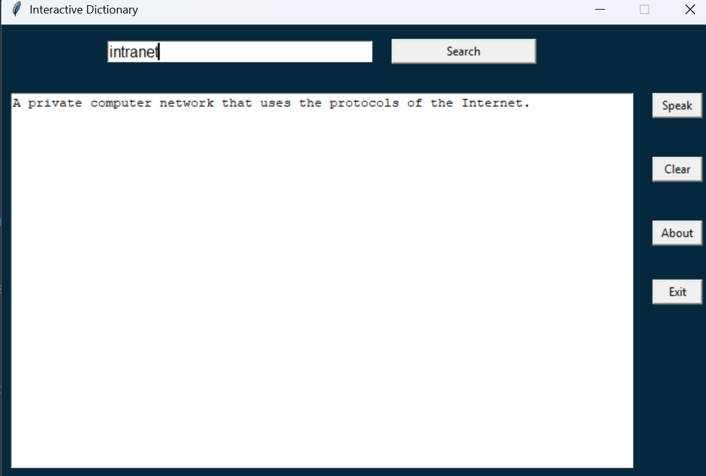

INTERACTIVE DICTIONARY:
A Python-based desktop dictionary application developed using Tkinter as part of an undergraduate third-semester academic project.

PROJECT OVERVIEW:
The Interactive Dictionary is a graphical desktop application that allows users to search for words, retrieve their definitions, receive spelling suggestions, and listen to spoken text through an integrated text-to-speech feature.
The application uses an SQLite database to store dictionary entries and Python's text-processing capabilities to suggest similar words when a searched word is not found.

FEATURES:
- Word Search: Search for words and retrieve their corresponding definitions.
- Word Suggestions: Suggests similar words when a spelling error or unmatched word is entered.
- Text-to-Speech: Reads displayed text aloud using the pyttsx3 speech library.
- Interactive GUI: Desktop interface developed using Tkinter.
- Database Integration: Uses SQLite to store and retrieve dictionary entries.

TECHNOLOGIES USED:
- Python
-Tkinter: Graphical User Interface
-SQLite3: Database Management
-pyttsx3: Text-to-Speech
-difflib: Similarity Matching and Word Suggestions
-threading: Background Speech Processing

PROJECT FILES:
-Python source code: Application implementation.
-dictionary.pd: SQLite dictionary database.
-requirements.txt: External Python dependencies.

HOW TO RUN:
1.Install Python on a Windows computer.
2.Download or clone this repository.
3.Install dependencies:
    pip install -r requirements.txt
4.Keep the Python source file and dictionary.pd in the same directory.
5.Run the application using:
     python dictionary_GUI.py

PROJECT DETAILS:
- Project: Interactive Dictionary
- Project Type: Academic Coursework
- Semester: Third Semester
- Programming Language: Python
- Application Type: Desktop GUI Application

APPLICATION PREVIEW:

CONTRIBUTORS:
Pawana Gyawali
Sachin Subedi (Group member)

